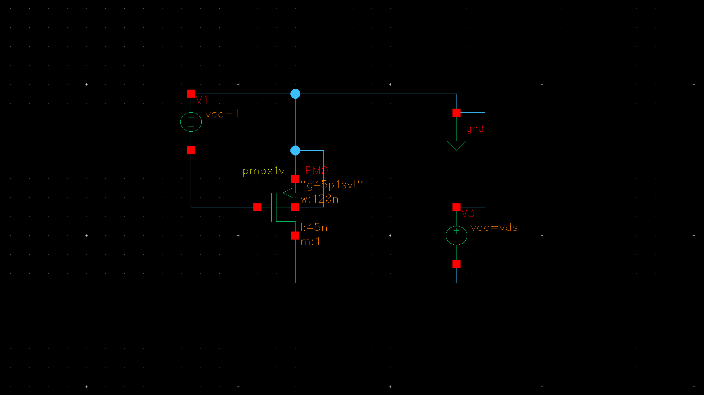
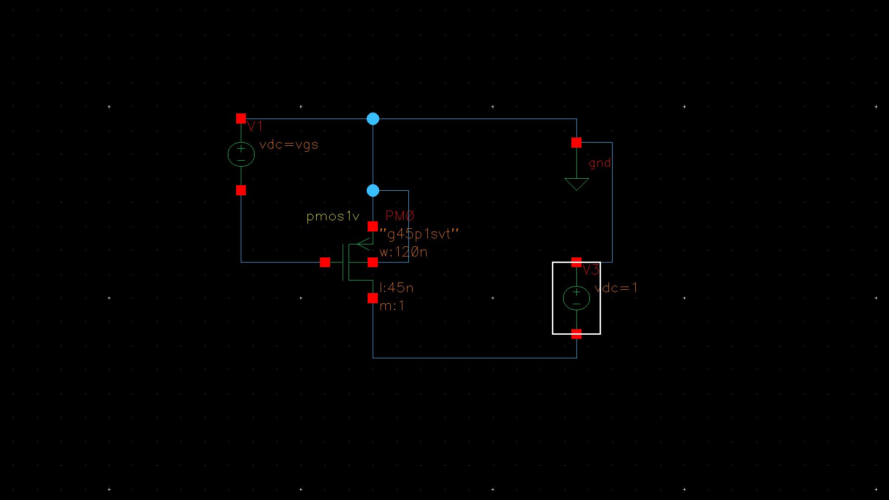
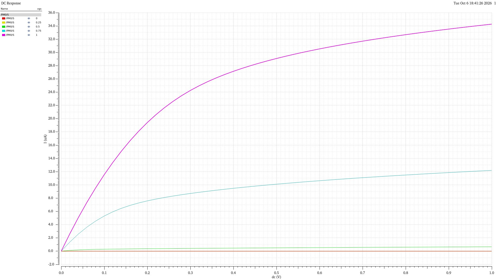
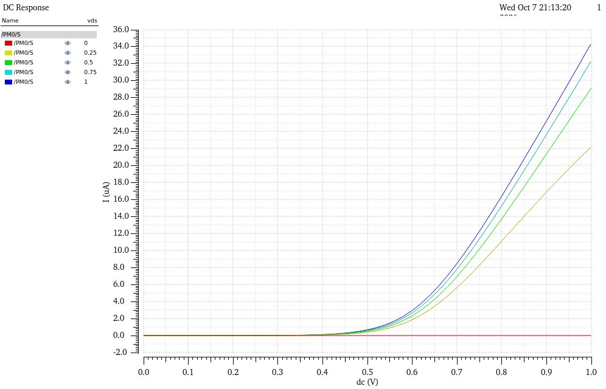
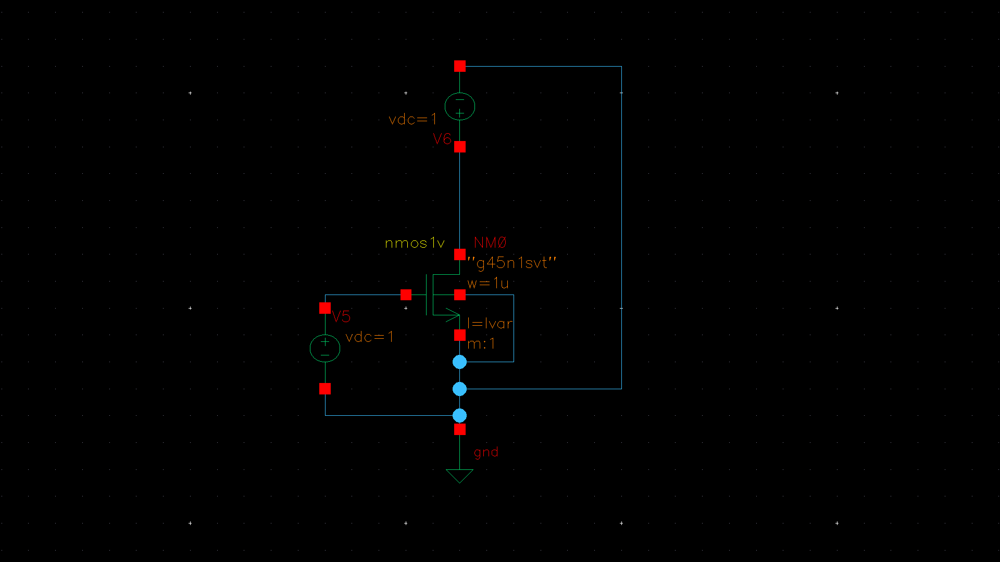
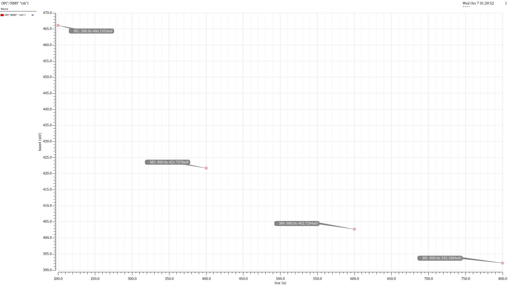

# MOSFET Characterization

> **Assignment reference:** Assignment 1 — MOSFET Characterisation  
> **PDK:** 45 nm (as stated in the assignment material)  
> **Simulator:** Cadence Virtuoso (inferred from the schematic/plot presentation; please confirm)  
> **Status:** Evidence received for both questions; documentation reflects the supplied assignment scope.

## Objective

Characterize MOSFET DC behavior using drain-current sweeps and examine threshold-voltage variation with channel length.

## Q1 — PMOS Characterization

The supplied assignment material identifies Q1 as PMOS characterization:
- \(I_D\)-\(V_{DS}\) characteristics for different \(V_{GS}\)
- \(I_D\)-\(V_{GS}\) characteristics for different \(V_{DS}\)

### Device and testbench details visible in the supplied schematics

| Parameter | Visible setting |
|---|---:|
| Device | `pmos1v` |
| Model text | `g45p1svt` |
| Width | 120 nm |
| Length | 45 nm |
| Multiplicity | 1 |
| Supply shown | 1 V |

The supplied \(I_D\)-\(V_{DS}\) plot shows a gate-bias sweep of 0, 0.25, 0.5, 0.75, and 1 V, with the drain sweep extending from 0 to 1 V.

The supplied \(I_D\)-\(V_{GS}\) plot shows a drain-bias sweep of 0, 0.25, 0.5, 0.75, and 1 V, with the gate sweep extending from 0 to 1 V.

### Q1 observations

- The drain current increases as the magnitude of the applied gate bias increases.
- At the zero-bias trace, the current is approximately zero over the displayed sweep.
- The \(I_D\)-\(V_{DS}\) curves rise at low drain bias and become less steep at higher drain bias, indicating the transition toward saturation-like behavior.
- For a fixed gate-bias trace, the drain current generally increases with drain bias; the amount of increase depends on gate bias.

**Sign convention note:** The screenshots show the simulator's plotted current as positive. For PMOS devices, document current and voltage magnitudes consistently with the simulator's terminal convention.

### Q1 figures

**Testbench — \(I_D\)-\(V_{DS}\) sweep**

**Testbench — \(I_D\)-\(V_{GS}\) sweep**

**\(I_D\)-\(V_{DS}\) characteristics for different \(V_{GS}\)**

**\(I_D\)-\(V_{GS}\) characteristics for different \(V_{DS}\)**

## Q2 — NMOS Threshold-Voltage Extraction

Q2 concerns threshold-voltage extraction versus channel length; it does not require NMOS output or transfer characteristic plots. The supplied NMOS testbench has these visible settings:
- Device: `nmos1v`
- Model text: `g45n1svt`
- Width: 1 µm
- Length: `lvar` (swept variable)
- Multiplicity: 1
- Gate and drain DC sources: 1 V each; source is grounded.

The supplied threshold-voltage plot is labelled as the NMOS operating-point threshold voltage versus `lvar`.

| Channel length | Extracted \(V_{th}\) shown |
|---:|---:|
| 200 nm | 466.1553 mV |
| 400 nm | 421.7278 mV |
| 600 nm | 402.7294 mV |
| 800 nm | 392.1884 mV |

### Q2 observation

Across the displayed length sweep, the extracted threshold voltage decreases as channel length increases. These values are transcribed from the plot markers; they should be treated as the values displayed by the simulation, not as universal process parameters.

**NMOS testbench**

**NMOS threshold voltage versus channel length**

## Scope Notes

- Q1 contains the PMOS \(I_D\)-\(V_{DS}\) and \(I_D\)-\(V_{GS}\) characteristic sweeps.
- Q2 contains NMOS threshold-voltage extraction versus channel length only.
- Assignment 1 does not require a separate calculations section; therefore, no calculation results are claimed here.

## Conclusion

The supplied evidence covers the two stated parts of Assignment 1: PMOS DC characteristics for Q1 and NMOS threshold-voltage extraction for Q2. No NMOS characteristic plots or separate calculation section are required for this assignment.
