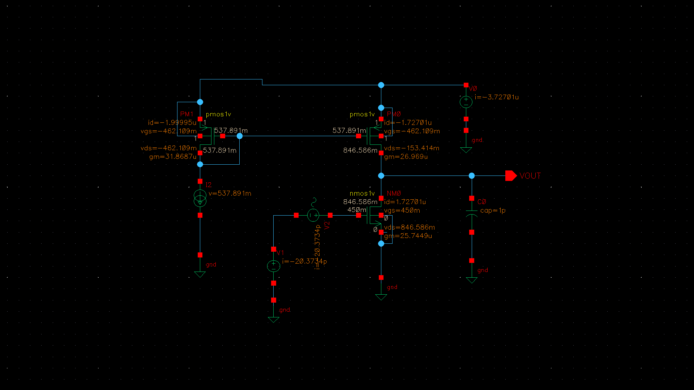
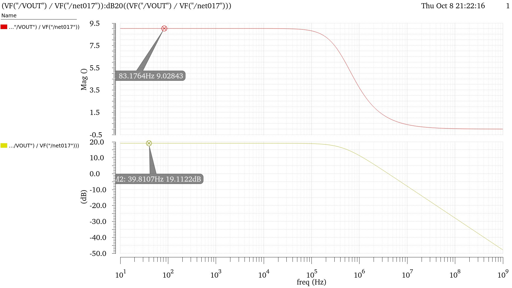
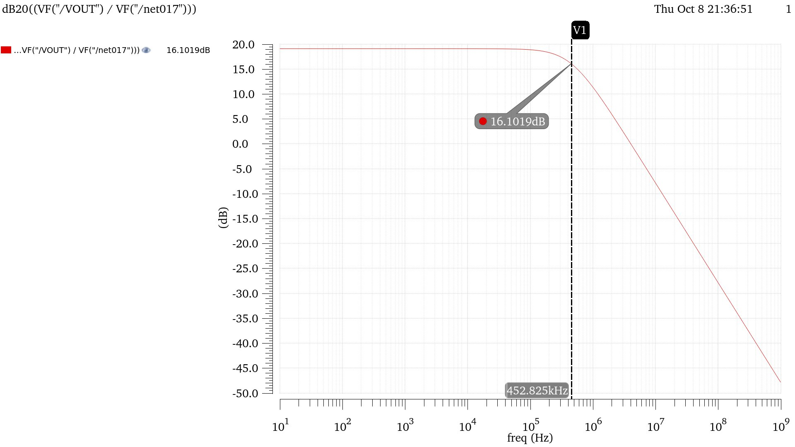
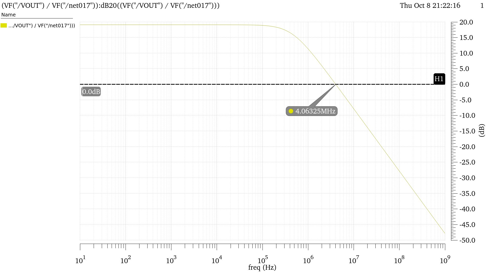
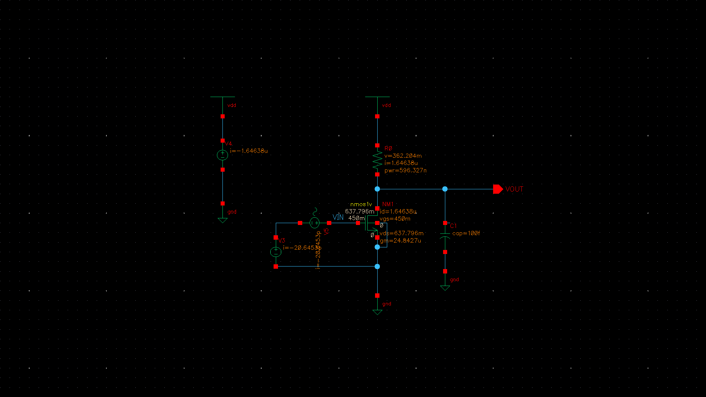
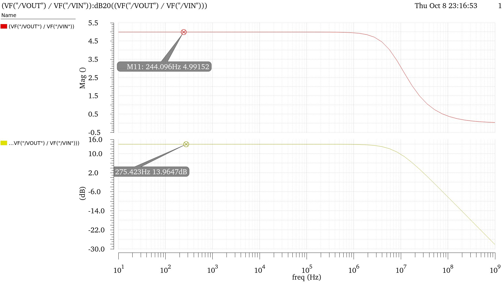
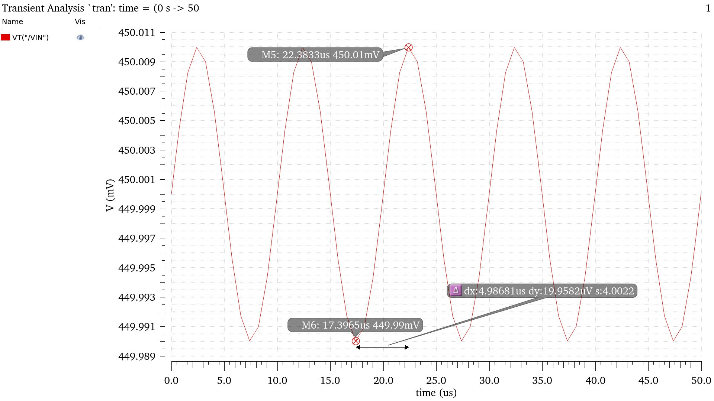
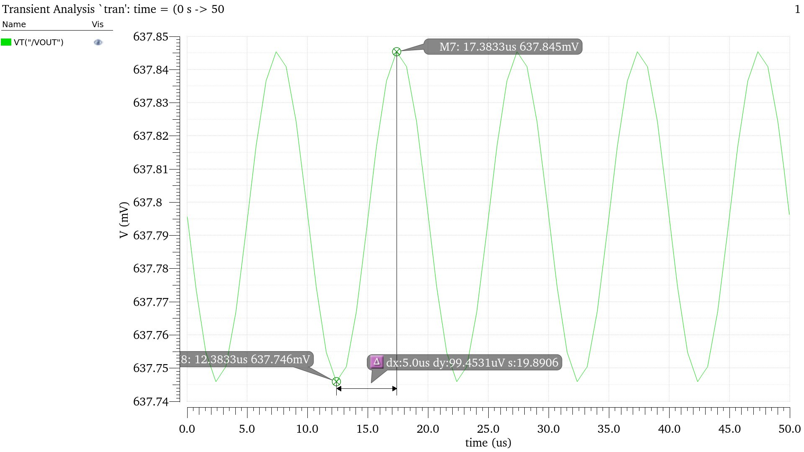
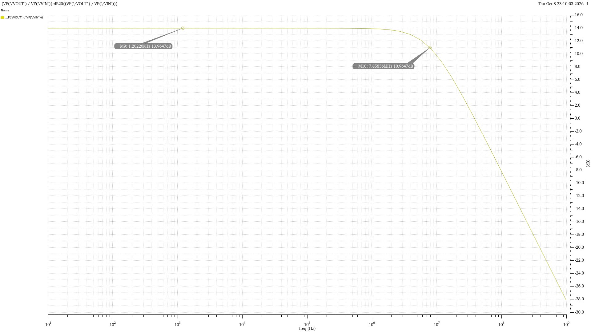

# Assignment 03 — Common-Source (CS) Amplifiers

This assignment covers the design and simulation of two common-source MOSFET amplifiers using the **45 nm GPDK PDK** and a **1 V supply**.

## Included contents

📁 **Q1 — PMOS-Load Common-Source Amplifier**

- Circuit schematic with DC operating-point annotations.
- Gain-versus-frequency response (linear gain and dB).
- Dominant-pole location.
- Unity-gain frequency plot.
- Theoretical gain, pole/zero, and phase-margin calculations.

📁 **Q2 — Resistive-Load Common-Source Amplifier**

- Circuit schematic with DC operating-point annotations.
- AC gain-versus-frequency response.
- −3 dB bandwidth plot.
- Input and output transient waveforms.
- DC, AC, transient, gain-bandwidth product, and noise results.

All screenshots are organized into the `images/Schematics/`, `images/Frequency_Response/`, and `images/Transient/` directories and displayed below.

---

## Q1 — PMOS-Load Common-Source Amplifier

**Objective:** Design a PMOS-load common-source amplifier, calculate its voltage gain and pole locations, verify the gain using an AC response plot, and determine the unity-gain frequency and phase margin.

**Design conditions**

| Parameter | Value |
|---|---:|
| PDK | GPDK 45 nm |
| Supply voltage, VDD | 1 V |
| NMOS dimensions, W/L | 1 µm / 1 µm |
| PMOS dimensions, W/L | 1 µm / 1 µm |
| Output capacitance, C0 | 1 pF |
| NMOS transconductance, gm,n | 25.7449 µS |

### Circuit schematic

### Theoretical calculations

The common-source voltage gain is approximated by:

\[
A_v=-g_{m,n}R_{out}
\]

The dominant pole is:

\[
f_{p1}=\frac{1}{2\pi R_{out}C_0}
\]

Using the dominant-pole frequency read from the AC response, \(f_{p1}=452.825\,\text{kHz}\):

\[
R_{out}=\frac{1}{2\pi f_{p1}C_0}
=\frac{1}{2\pi(452.825\times10^3)(1\times10^{-12})}
\approx351.4\,\text{k}\Omega
\]

Therefore,

\[
A_v=-(25.7449\times10^{-6})(351.4\times10^3)
\approx-9.05\,\text{V/V}
\]

\[
|A_v|\approx9.05\,\text{V/V},\qquad
A_v(\text{dB})=20\log_{10}(9.05)\approx19.13\,\text{dB}
\]

### Simulation plots

**Gain versus frequency**

**Dominant-pole location**

**Unity-gain frequency**

### Pole, zero, unity-gain frequency, and phase margin

The values reported in the reference calculations are:

| Quantity | Value |
|---|---:|
| Dominant pole, fp1 | 452.825 kHz |
| Second pole, fp2 | 273.188 MHz |
| Zero, fz | 273.076 MHz |
| Unity-gain frequency, fu | 4.06325 MHz |
| Theoretical phase margin (as calculated in the reference) | −83.64° |

The phase calculation in the reference uses:

\[
\phi(f_u)=-180^\circ-\tan^{-1}\left(\frac{f_u}{f_{p1}}\right)
-\tan^{-1}\left(\frac{f_u}{f_{p2}}\right)
+\tan^{-1}\left(\frac{f_u}{f_z}\right)
\]

With the listed values, the reference obtains \(\phi(f_u)\approx-263.641^\circ\), and hence:

\[
PM=180^\circ+\phi(f_u)\approx-83.64^\circ
\]

**Note:** This is reproduced from the supplied assignment calculation. A negative phase margin should be interpreted cautiously: phase margin is formally a feedback-loop stability metric and should be evaluated from the loop-gain response, not inferred solely from a forward voltage-gain plot.

### Q1 final results

| Parameter | Theoretical | Simulation / reported |
|---|---:|---:|
| Voltage gain magnitude | 9.05 V/V | 9.02 V/V |
| Voltage gain | 19.13 dB | 19.11 dB |
| Dominant pole | 452.825 kHz | 452.825 kHz |
| Unity-gain frequency | — | 4.06325 MHz |
| Phase margin | −83.64° (reference calculation) | — |

---

## Q2 — Resistive-Load Common-Source Amplifier

**Objective:** Design a resistive-load common-source amplifier for a target voltage gain of approximately \(-5\,\text{V/V}\), driving a load capacitance of 100 fF. Verify its operation using DC, AC, and transient simulations, and obtain bandwidth, gain-bandwidth product, and input-referred noise.

### Design conditions and DC operating point

| Parameter | Value |
|---|---:|
| Supply voltage, VDD | 1 V |
| NMOS dimensions, W/L | 1 µm / 1 µm |
| Drain resistance, RD | 220 kΩ |
| Input DC bias, VIN | 450 mV |
| Load capacitance, CL | 100 fF |
| Drain current, ID | 1.64638 µA |
| Gate-source voltage, VGS | 450 mV |
| Drain-source voltage, VDS | 637.796 mV |
| Transconductance, gm | 24.8427 µS |

### Circuit schematic

### Theoretical voltage gain

For the resistive-load common-source stage:

\[
A_v\approx-g_mR_D
\]

\[
A_v=-(24.8427\,\mu\text{S})(220\,\text{k}\Omega)
\approx-5.4653\,\text{V/V}
\]

### AC simulation

The AC simulation reports:

- Gain magnitude: 4.99152 V/V.
- Gain: 13.9647 dB.

### Transient simulation

The input is a sinusoid with a 450 mV DC bias, 10 µV amplitude, and 100 kHz frequency.

**Input waveform**

**Output waveform**

The peak-to-peak input voltage is:

\[
V_{in(pp)}=450.010\,\text{mV}-449.990\,\text{mV}
\approx19.9582\,\mu\text{V}
\]

The peak-to-peak output voltage is:

\[
V_{out(pp)}=637.845\,\text{mV}-637.745\,\text{mV}
\approx99.4531\,\mu\text{V}
\]

Thus, the transient gain magnitude is:

\[
|A_v|=\frac{V_{out(pp)}}{V_{in(pp)}}
=\frac{99.4531}{19.9582}\approx4.9831\,\text{V/V}
\]

Since the common-source stage inverts the signal:

\[
A_v\approx-4.9831\,\text{V/V}
\]

### Bandwidth and gain-bandwidth product

The −3 dB level relative to the midband gain is:

\[
13.9647-3=10.9647\,\text{dB}
\]

The measured bandwidth is 7.85836 MHz. Therefore:

\[
GBW=|A_v|\times BW
\]

\[
GBW=4.99152\times7.85836\,\text{MHz}
\approx39.23\,\text{MHz}
\]

### Noise analysis

The reference assignment reports the input-referred voltage-noise result as:

\[
181.541\;\text{V}^2/\text{Hz}
\]

This value and unit are transcribed as provided in the source document.

### Q2 final results

| Parameter | Value |
|---|---:|
| Theoretical voltage gain | −5.4653 V/V |
| AC gain magnitude | 4.99152 V/V (13.9647 dB) |
| Transient voltage gain | −4.9831 V/V |
| −3 dB bandwidth | 7.85836 MHz |
| Gain-bandwidth product | 39.23 MHz |
| Load capacitance | 100 fF |
| Input-referred voltage-noise result (as reported) | 181.541 V²/Hz |

---

## Overall conclusion

Both common-source amplifier configurations were simulated and their gain responses were examined. The PMOS-load stage produced a reported practical gain of approximately 9.02 V/V, while the resistive-load stage produced a transient gain of approximately −4.9831 V/V, close to the target of −5 V/V. The resistive-load stage also showed a measured bandwidth of 7.85836 MHz and a gain-bandwidth product of approximately 39.23 MHz.
