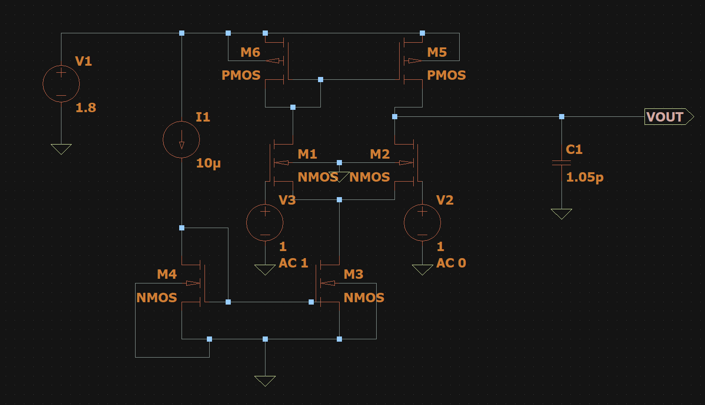
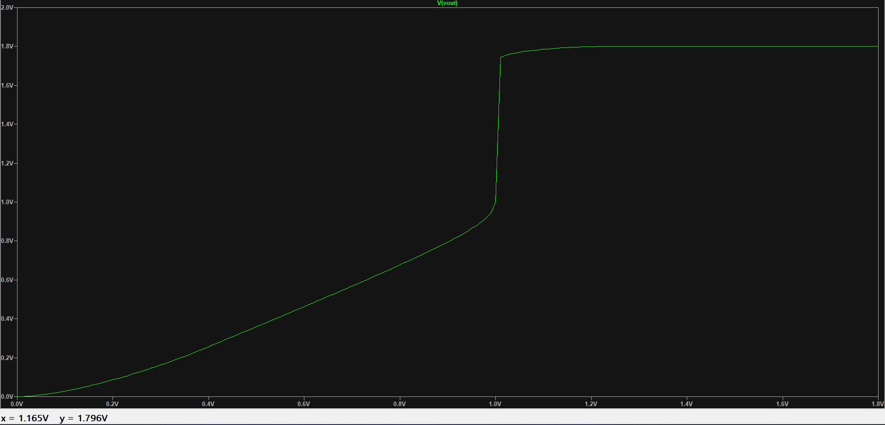
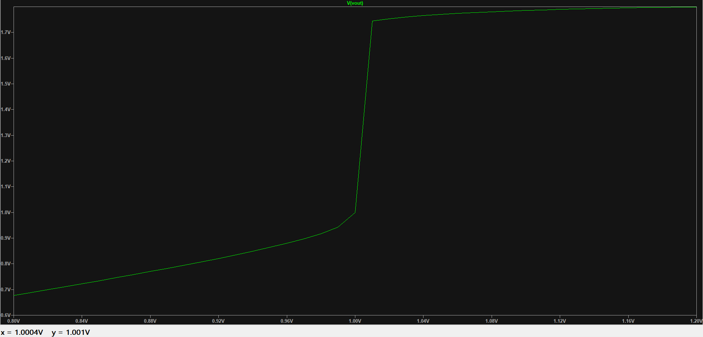
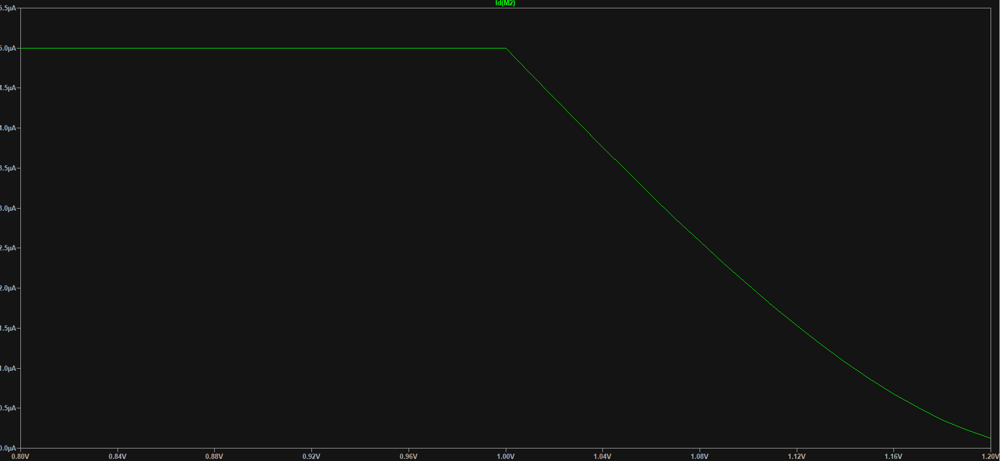
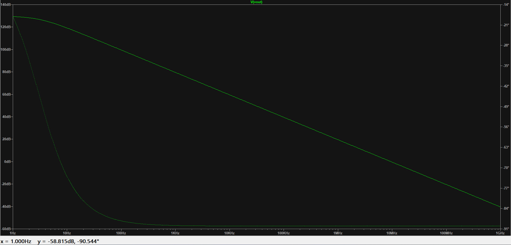

# Single-Stage CMOS Operational Amplifier

## Objective

Design and simulate a single-stage CMOS operational amplifier and examine its DC and AC characteristics.

## Design Specifications

| Parameter | Value |
|---|---:|
| Supply voltage, VDD | 1.8 V |
| Mirror current, Imirror | 10 µA |
| Load capacitance, CL | 1.05 pF |
| NMOS dimensions (M1–M4) | W = 350 nm, L = 180 nm |
| PMOS dimensions (M5–M6) | W = 1300 nm, L = 180 nm |
| DC input values for NMOS devices | 1 V |
| AC input values | 1 V |

The transistor dimensions and bias conditions are summarized as:

$$
\begin{aligned}
W_{M1-M4} &= 350\,\text{nm}, & L_{M1-M4} &= 180\,\text{nm} \\
W_{M5-M6} &= 1300\,\text{nm}, & L_{M5-M6} &= 180\,\text{nm}
\end{aligned}
$$

## Circuit Schematic

The six-transistor single-stage CMOS op-amp schematic used for simulation is shown below.

## DC Characteristics

The complete DC sweep shows the output-voltage response over the 0–1.8 V input range. A second plot provides a closer view of the transition region from 0.8 V to 1.2 V. The drain current of M2 is plotted against the swept input voltage.

## AC Characteristics

The AC analysis plots show the gain and phase response over the frequency range from 1 Hz to 1 GHz. The cursor in the 1 GHz plot indicates an output magnitude of −40.569 dB and phase of −83.519°.

## Conclusion

The single-stage CMOS operational amplifier was simulated and its DC and AC responses were examined. The DC results include the output-voltage transfer characteristic and M2 drain-current response. The AC results show the frequency-dependent gain and phase behavior.
