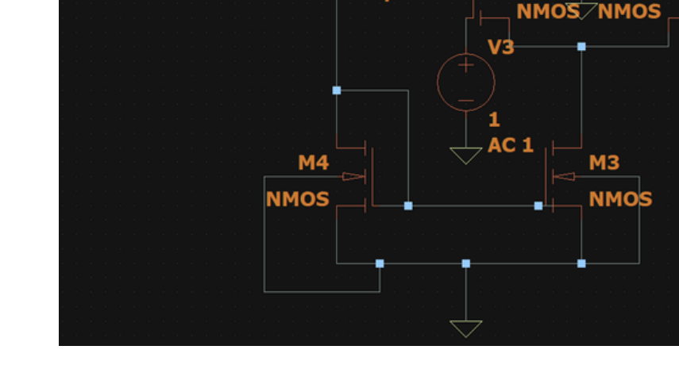
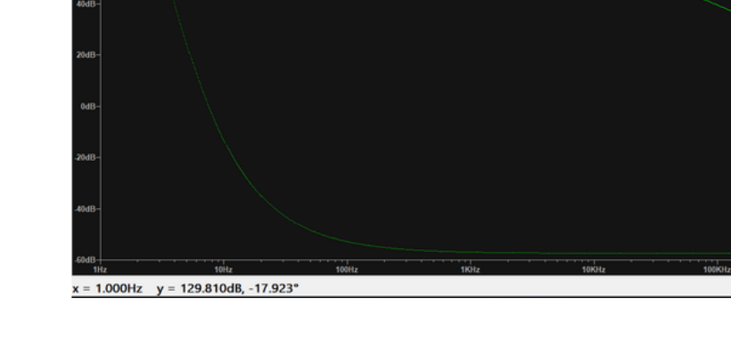

# Single-Stage CMOS Operational Amplifier

## Objective

Design and simulate a single-stage CMOS operational amplifier and examine its DC and AC characteristics.

## Design Specifications

| Parameter | Value |
|---|---:|
| Supply voltage, VDD | 1.8 V |
| Mirror current, Imirror | 10 µA |
| Load capacitance, CL | 1.05 pF |
| NMOS dimensions (M1–M4) | W = 350 nm, L = 180 nm |
| PMOS dimensions (M5–M6) | W = 1300 nm, L = 180 nm |
| DC input values for NMOS devices | 1 V |
| AC input values | 1 V |

## Circuit Schematic

The six-transistor single-stage CMOS op-amp schematic and device dimensions are shown below.

## DC Characteristics

The DC output-voltage sweep shows a steep transition around 1 V, followed by an approximately constant output level. The M2 drain-current characteristic is also included as recorded in the assignment.

## AC Characteristics

The AC response plots show the gain and phase variation over frequency. The source document records an initial output gain of 128.81 dB and an output value of −40.569 dB near 1 GHz.

## Conclusion

The DC and AC characteristics of the single-stage CMOS operational amplifier were simulated and analyzed. The DC plots show the output-voltage transition and the M2 drain-current response. The AC plots show the frequency-dependent gain and phase response of the amplifier.

## Reference

*Analog Assignments.pdf*, Assignment No. 4: Single Stage CMOS Op-Amp, pages 30–32.
