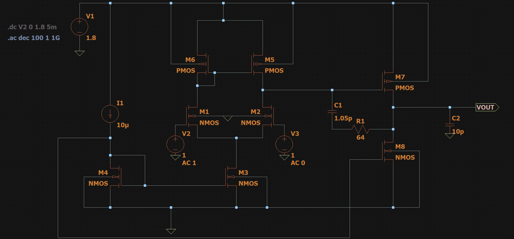
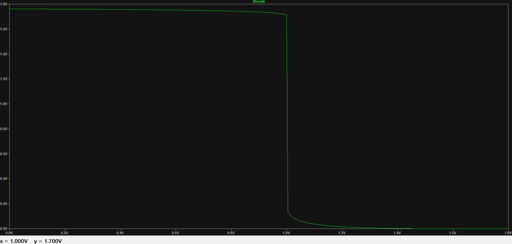
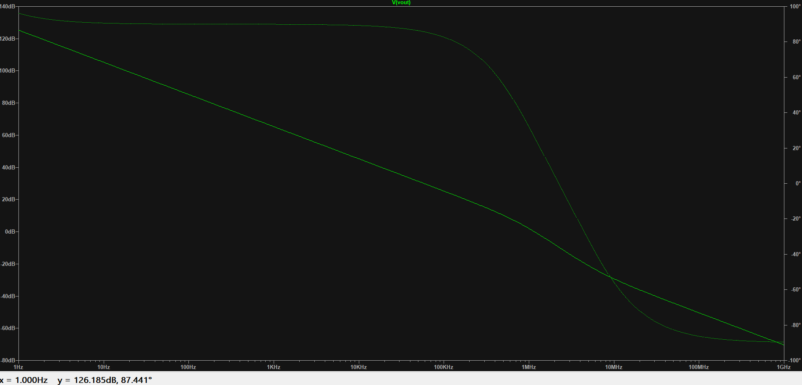
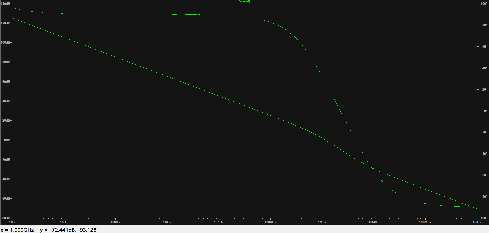

# Two-Stage CMOS Operational Amplifier

## Design Specifications

A two-stage CMOS operational amplifier was designed and simulated using the specifications below.

| Parameter | Value |
|---|---:|
| Supply voltage, \(V_{DD}\) | 1.8 V |
| Mirror current, \(I_{mirror}\) | 10 µA |
| Compensation capacitor, \(C_1\) | 1.05 pF |
| Load capacitor, \(C_2\) | 10 pF |
| Load resistance, \(R_L\) | 64 Ω |
| NMOS width, \(W_n\) | 350 nm |
| NMOS channel length, \(L_n\) | 180 nm |
| PMOS width, \(W_p\) | 1300 nm |
| PMOS channel length, \(L_p\) | 180 nm |
| NMOS DC input bias | 1 V |
| AC input magnitude | 1 V |

## Transistor Dimensions

| MOSFET | Width (\(W\)) | Length (\(L\)) |
|---|---:|---:|
| M1 | 350 nm | 180 nm |
| M2 | 350 nm | 180 nm |
| M3 | 350 nm | 180 nm |
| M4 | 350 nm | 180 nm |
| M5 | 1300 nm | 180 nm |
| M6 | 1300 nm | 180 nm |
| M7 | 1300 nm | 180 nm |
| M8 | 350 nm | 180 nm |

## Circuit Schematic

The circuit consists of a differential input stage, current-mirror loads, and a second gain stage. The output is loaded by \(C_2\), with \(C_1\) and \(R_L\) connected in the interstage/output network as shown in the schematic.

## DC Analysis

The DC sweep was performed by varying the input voltage from 0 V to 1.8 V.

### Output Voltage Around the Operating Point

The input was examined over the 0.8–1.2 V range. At the nominal input bias of 1 V, the provided plot cursor indicates an output voltage of approximately 1.70 V. The assignment record reports 1.71 V.

### Full Input Sweep

| Characteristic | Observed value |
|---|---:|
| Input sweep range | 0–1.8 V |
| Approximate maximum output voltage | 1.76 V |
| Approximate minimum output voltage | 0 V |
| Approximate switching threshold | 1.0 V |

The output remains near the upper rail for input voltages below the switching region and falls toward the lower rail as the input passes approximately 1 V.

## AC Analysis

The AC sweep was configured logarithmically from 1 Hz to 1 GHz with 100 points per decade. The plots show the output magnitude and phase response.

### Low-Frequency Response

At 1 Hz, the provided plot cursor indicates:

- Gain: 126.185 dB
- Phase: 87.441°

The assignment record separately lists a low-frequency gain of 125.142 dB and phase of 86.493° at 1 Hz.

### High-Frequency Response

At the upper end of the provided plot, the cursor indicates:

- Frequency: 1 GHz
- Gain: −72.441 dB
- Phase: −93.128°

The assignment record also lists −70.616 dB and −91.469° at 988.703 MHz.

## Conclusion

The two-stage CMOS operational amplifier was evaluated using DC and AC analyses. The DC response shows a switching transition near a 1 V input, with the output approaching the supply and ground rails. The AC response exhibits high low-frequency gain followed by decreasing gain and phase shift as frequency increases.
