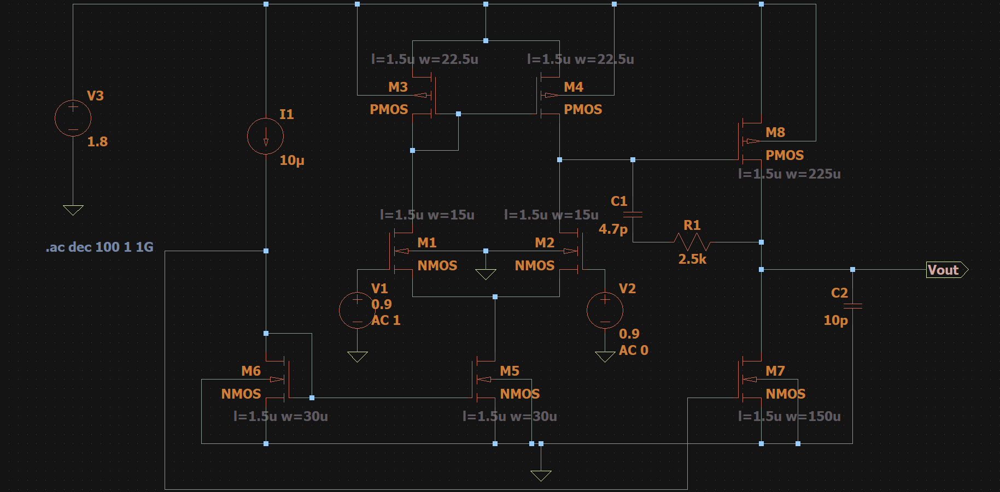
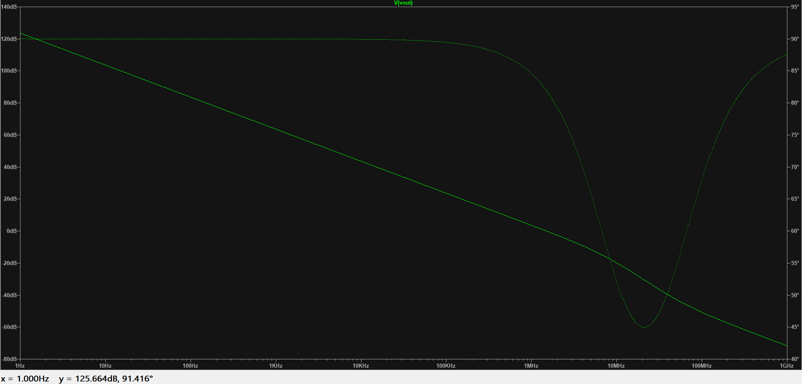

# Two-Stage CMOS Operational Amplifier Design

## Project Overview

This mini project presents the design and simulation of a two-stage CMOS operational amplifier using a differential input stage, an active PMOS current-mirror load, a common-source second stage, and Miller frequency compensation. The design uses a 1.8 V supply and a 10 pF output load.

The project report documents the design methodology, analytical calculations, transistor sizing, bias-current selection, DC operating-point verification, power estimation, AC frequency-response analysis, transient slew-rate evaluation, and pole-zero calculations.

## Design Specifications

| Parameter | Target specification |
|---|---:|
| DC open-loop gain | ≥ 60 dB |
| Gain-bandwidth product (GBW) | ≤ 1 MHz |
| Phase margin | ≥ 60° |
| Slew rate | Approximately 5 V/µs |
| Load capacitance, C<sub>L</sub> | 10 pF |
| Supply voltage, V<sub>DD</sub> | 1.8 V |

The design report uses typical first-order long-channel parameters for a 180 nm CMOS process:

| Parameter | Value used |
|---|---:|
| μ<sub>n</sub>C<sub>ox</sub> | 300 µA/V² |
| μ<sub>p</sub>C<sub>ox</sub> | 60 µA/V² |
| V<sub>tn</sub> | 0.5 V |
| V<sub>tp</sub> | −0.5 V |

## Circuit Architecture

The amplifier consists of the following functional blocks:

1. **Input differential pair (M1–M2):** NMOS differential pair driven by the two input sources.
2. **Active load (M3–M4):** PMOS current-mirror load that converts the differential signal into a single-ended first-stage output.
3. **Bias and current-mirror network (M5–M7):** Establishes the tail current and second-stage bias current from the reference branch.
4. **Second gain stage (M8):** PMOS common-source output driver.
5. **Frequency compensation:** Compensation capacitor C1 and series nulling resistor R1 connect the first-stage and output-stage nodes. C2 represents the output load capacitance.

### Schematic



## Design Methodology and Analytical Calculations

### 1. Compensation capacitor selection

For the target phase margin, the report begins with the design condition:

$$
C_1 \geq 0.22 C_L
$$

For C<sub>L</sub> = 10 pF:

$$
C_1 \geq 0.22 \times 10 = 2.2\text{ pF}
$$

The selected compensation capacitor is increased to:

$$
C_1 = 4.7\text{ pF}
$$

The report selects this value to place the unity-gain frequency near the 1 MHz target while supporting stability.

### 2. Tail-current and bias-current selection

The slew-rate relation used in the report is:

$$
SR = \frac{I_{\text{tail}}}{C_1}
$$

Using the target slew rate and selected compensation capacitor:

$$
I_{\text{tail}} = SR \times C_1
$$

$$
I_{\text{tail}} = 5\text{ V}/\mu\text{s} \times 4.7\text{ pF}
= 23.5\ \mu\text{A}
$$

The implemented reference current is 10 µA. The report states that M5 mirrors this reference current, giving a 10 µA tail current and nominally 5 µA in each differential branch:

$$
I_{D1}=I_{D2}=\frac{I_{D5}}{2}=5\ \mu\text{A}
$$

The second-stage branch is designed for a nominal current of 50 µA.

### 3. Input-stage transconductance

The gain-bandwidth relation used is:

$$
GBW = \frac{g_{m1}}{2\pi C_1}
$$

For a 1 MHz target and C1 = 4.7 pF:

$$
g_{m1}=2\pi \times GBW \times C_1
$$

$$
g_{m1}=2\pi \times 1\text{ MHz}\times4.7\text{ pF}
\approx 29.53\ \mu\text{A/V}
$$

Using the square-law expression:

$$
\displaystyle
(W/L)_{1,2} =
\frac{g_{m1}^{2}}
{2\,\mu_n C_{ox} I_{D1}}
$$

The report first obtains an analytical ratio of approximately 0.29, then scales the implemented input-pair dimensions to 15 µm / 1.5 µm (W/L = 10).

### 4. Second-stage transconductance

The report uses the following pole-separation condition:

$$
\omega_{p2}\geq 3\omega_{GBW}
$$

With the approximation:

$$
\omega_{p2}\approx\frac{g_{m8}}{C_2}
$$

the required transconductance is estimated as:

$$
g_{m8}\geq 3g_{m1}\frac{C_2}{C_1}
$$

$$
g_{m8}\geq
3\times29.53\ \mu\text{A/V}
\times\frac{10\text{ pF}}{4.7\text{ pF}}
\approx188.5\ \mu\text{A/V}
$$

The selected M8 dimensions are 225 µm / 1.5 µm (W/L = 150), with a nominal second-stage current of 50 µA.

### 5. Nulling resistor

The report identifies a right-half-plane zero associated with the compensation path and uses a series nulling resistor to shift the zero to the left half-plane. The selected value is:

$$
R_1=2.5\text{ k}\Omega
$$

The reported zero expression is:

$$
\omega_z =
\frac{1}{C_1\left(\frac{1}{g_{m8}}-R_1\right)}
$$

The report states that choosing R1 greater than 1/gm8 moves the zero into the left half-plane and improves the high-frequency phase response.

## Transistor Sizing and Bias Currents

The final sizing table from the project report is reproduced below.

| Transistor | Type | Function | Width | Length | W/L | Reported drain current |
|---|---|---|---:|---:|---:|---:|
| M1 | NMOS | Positive input differential pair | 15 µm | 1.5 µm | 10 | 5 µA |
| M2 | NMOS | Negative input differential pair | 15 µm | 1.5 µm | 10 | 5 µA |
| M3 | PMOS | Left active-mirror load | 22.5 µm | 1.5 µm | 15 | 5 µA |
| M4 | PMOS | Right active-mirror load | 22.5 µm | 1.5 µm | 15 | 5 µA |
| M5 | NMOS | First-stage tail-current source | 30 µm | 1.5 µm | 20 | 10 µA |
| M6 | NMOS | Diode-connected reference device | 30 µm | 1.5 µm | 20 | 10 µA |
| M7 | NMOS | Second-stage active-load device | 150 µm | 1.5 µm | 100 | 50 µA |
| M8 | PMOS | Second-stage common-source driver | 225 µm | 1.5 µm | 150 | 50 µA |

## DC Operating-Point Analysis

The submitted report lists the following operating-point values:

| Node / parameter | Reported value |
|---|---:|
| Supply voltage | 1.800 V |
| Input common-mode voltage (Vin1 / Vin2) | 0.900 V |
| Tail node voltage | 0.224 V |
| First-stage output / M8 gate voltage | 1.618 V |
| PMOS load-mirror gate voltage | 1.617 V |
| NMOS mirror-bias gate voltage | 0.676 V |
| Output quiescent voltage | 1.618 V |

### Saturation-region checks

For an NMOS device, the report uses:

$$
V_{DS}\geq V_{GS}-V_{th}
$$

For M1 and M2:

$$
V_{GS}=0.900-0.224=0.676\text{ V}
$$

$$
V_{DS1}=1.617-0.224=1.393\text{ V}
$$

$$
V_{DS2}=1.618-0.224=1.394\text{ V}
$$

With V<sub>tn</sub> ≈ 0.5 V, the overdrive voltage is approximately 0.176 V. The report concludes that the input pair operates in saturation.

For M8, the report lists:

$$
V_{SG8}=1.800-1.618=0.182\text{ V}
$$

$$
V_{SD8}=1.800-1.618=0.182\text{ V}
$$

The report describes M8 as operating near the required saturation headroom.

### Total power consumption

The report calculates the total supply current as:

$$
I_{\text{total}}=|I(V_3)|=70\ \mu\text{A}
$$

The corresponding static power is:

$$
P_{DC}=V_{DD}I_{\text{total}}
$$

$$
P_{DC}=1.8\text{ V}\times70\ \mu\text{A}
=126\ \mu\text{W}
$$

## AC Analysis: Open-Loop Gain and Phase Response

The small-signal stage gains are expressed as:

$$
A_1=-g_{m1}(r_{o2}\parallel r_{o4})
$$

$$
A_2=-g_{m8}(r_{o7}\parallel r_{o8})
$$

The total open-loop DC gain is:

$$
A_{DC}=A_1A_2
$$

The report uses:

$$
GBW=\frac{g_{m1}}{2\pi C_1}
$$

### Submitted AC response



The report records the following AC performance:

- **DC open-loop gain:** approximately 125 dB.
- **Gain-bandwidth product:** 1.0 MHz, as reported in the project report.
- **Phase margin:** 88°, calculated in the report from a phase of approximately −92° at the unity-gain crossover.

The phase-margin calculation shown in the report is:

$$
PM=180^\circ-|{-92^\circ}|=88^\circ
$$

The uploaded Bode-plot screenshot displays the gain and phase traces over 1 Hz to 1 GHz. Its cursor readout at 1 Hz is 125.664 dB and 91.416°. The 1 GHz cursor readout is not included in this screenshot; no additional crossover value is inferred from those cursor readings.

## Transient Analysis and Slew-Rate Verification

The theoretical slew-rate expression is:

$$
SR=\left.\frac{dV_{out}}{dt}\right|_{\max}
=\frac{I_{\text{tail}}}{C_1}
$$

Using the 10 µA tail current and 4.7 pF compensation capacitor stated in the transient-analysis section:

$$
SR=\frac{10\ \mu\text{A}}{4.7\text{ pF}}
\approx2.13\text{ V}/\mu\text{s}
$$

The report specifies the input pulse as:

```text
PULSE(0.4 1.4 0.1u 1n 1n 2u 4u)
```

and the transient directive as:

```text
.tran 0 10u
```

The reported slew rates extracted from the output waveform are:

| Measurement | Reported slew rate |
|---|---:|
| Rising slew rate | Approximately +5.1 V/µs |
| Falling slew rate | Approximately −4.9 V/µs |

## Pole-Zero Analysis

The report gives the following small-signal transconductance values:

| Device group | Reported transconductance |
|---|---:|
| Input differential pair (M1, M2) | 173.2 µA/V |
| Active PMOS load (M3, M4) | 94.9 µA/V |
| Second-stage driver (M8) | 948.7 µA/V |

### Dominant pole

The report approximates the dominant pole as:

$$
\omega_{p1}\approx
\frac{1}{R_{out1}A_2C_1}
$$

where:

$$
R_{out1}=r_{o2}\parallel r_{o4}
$$

### Non-dominant pole

Using C2 = 10 pF:

$$
f_{p2}\approx\frac{g_{m8}}{2\pi C_2}
$$

$$
f_{p2}\approx
\frac{948.7\ \mu\text{A/V}}{2\pi\times10\text{ pF}}
\approx15.1\text{ MHz}
$$

### Compensation zero

The report uses:

$$
f_{z1}=
\frac{1}
{2\pi C_1\left(\frac{1}{g_{m8}}-R_1\right)}
$$

With the reported values, the report obtains:

$$
\frac{1}{g_{m8}}\approx1054\ \Omega
$$

and:

$$
f_{z1}\approx-14.7\text{ MHz}
$$

The negative sign is reported as the indication that the zero is in the left half-plane under the report's sign convention.

## Performance Summary

The following values are taken from the submitted report's summary table.

| Parameter | Target | Reported simulated performance |
|---|---:|---:|
| DC open-loop gain | ≥ 60 dB | 125 dB |
| Gain-bandwidth product | ≤ 1 MHz | 1.0 MHz |
| Phase margin | ≥ 60° | 88° |
| Slew rate | Approximately 5 V/µs | Approximately 5 V/µs |
| Load capacitance | 10 pF | 10 pF |
| Supply voltage | 1.8 V | 1.8 V |
| Total power consumption | Minimum | 126 µW |

## Notes on Reported Design Values

The project report contains several different values at different stages of the design discussion. For traceability, this README retains those values in the sections where they are stated in the report rather than silently reconciling them:

- The initial slew-rate sizing calculation gives a tail current of 23.5 µA for 5 V/µs with C1 = 4.7 pF. The implemented bias section subsequently specifies a 10 µA mirrored tail current.
- The theoretical slew rate calculated from 10 µA and 4.7 pF is approximately 2.13 V/µs, while the report's transient measurements are approximately +5.1 V/µs and −4.9 V/µs.
- The report first calculates an input-stage transconductance of approximately 29.53 µA/V for the 1 MHz GBW target, and later lists 173.2 µA/V from the selected transistor dimensions in the pole-zero section.

These distinctions are preserved from the submitted report and should be considered when reproducing or independently validating the design.

## Repository Contents

```text
Analog_Mini_Project_Two_Stage_CMOS_OpAmp/
├── images/
│   ├── Schematic/
│   │   └── Two_Stage_CMOS_OpAmp_Schematic.png
│   └── AC_Analysis/
│       └── Open_Loop_Gain_and_Phase_Response.png
├── Two_Stage_CMOS_OpAmp_Project_Report.pdf
└── README.md
```

## Project Report

The complete submitted project report is included in this repository:

[Two-Stage CMOS Op-Amp Project Report](Two_Stage_CMOS_OpAmp_Project_Report.pdf)
