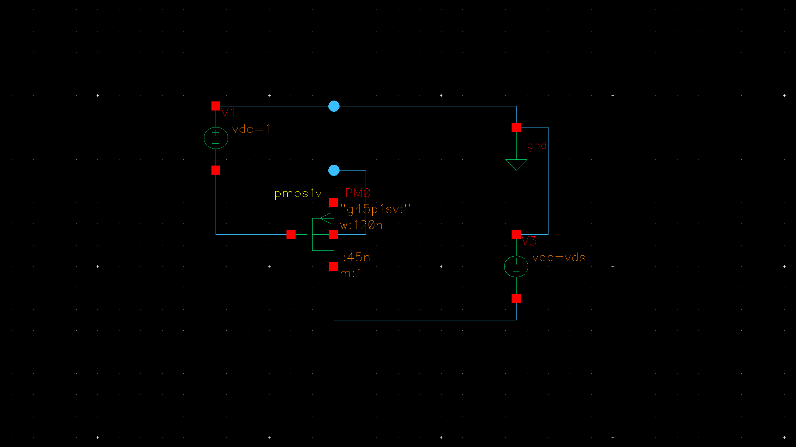
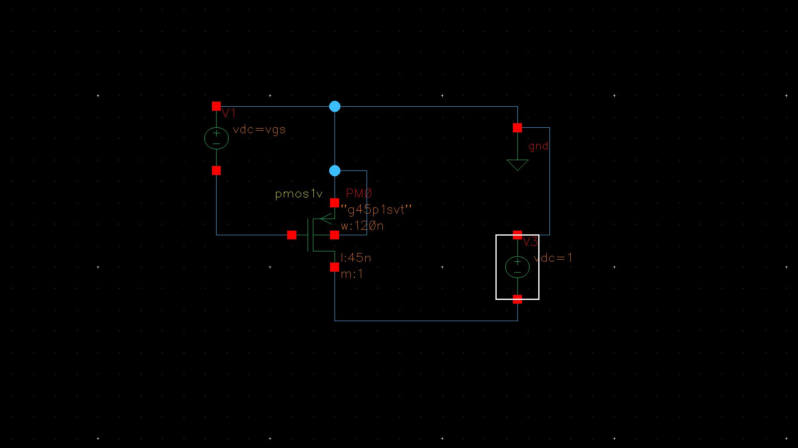
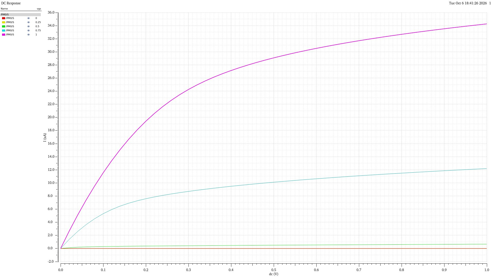
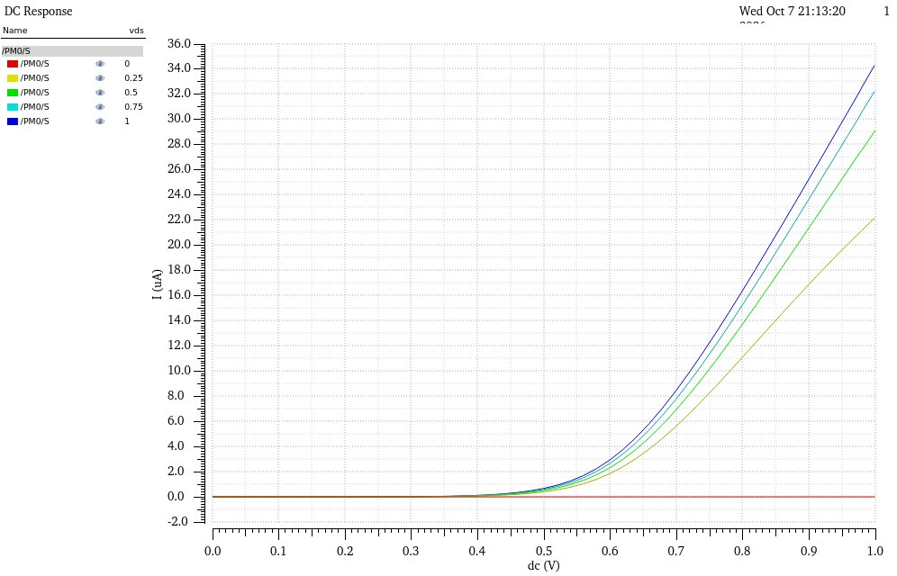
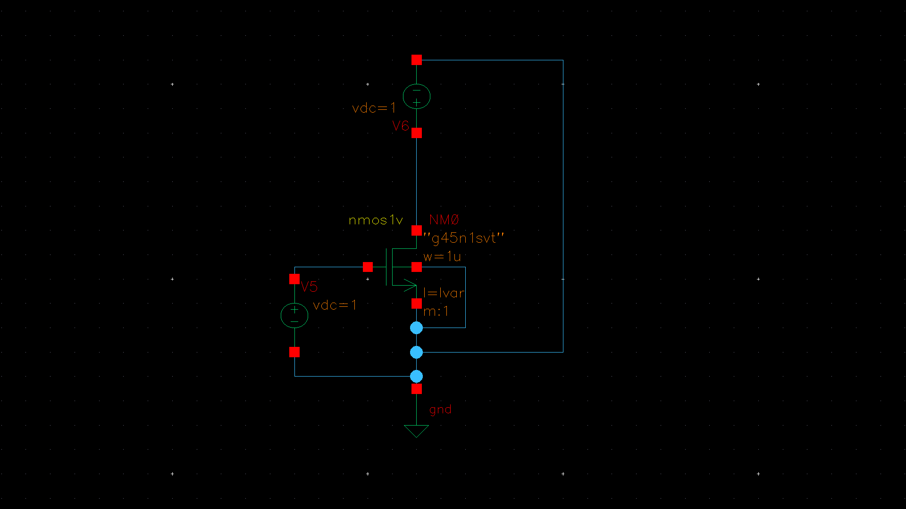
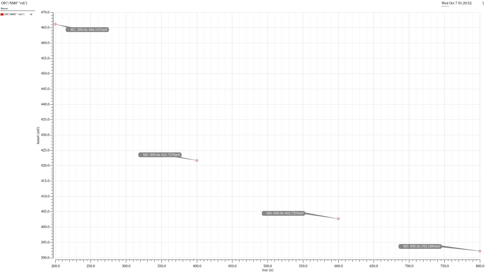

# Assignment 01 — MOSFET Characterization

## Objective

Characterize the DC current–voltage behaviour of a PMOS transistor and extract the NMOS threshold voltage for different channel lengths.

## Technology and Device Setup

| Parameter | Setting |
|---|---:|
| PDK | GPDK45 |
| Device for Q1 | PMOS1V (`g45p1svt`) |
| PMOS width | 120 nm |
| PMOS length | 45 nm |
| Multiplicity | 1 |
| Supply shown in testbench | 1 V |

## Q1 — PMOS Current–Voltage Characteristics

The PMOS device was simulated for the following characteristics:

1. Drain current, \(I_D\), versus drain-to-source voltage, \(V_{DS}\), for different gate-to-source voltages, \(V_{GS}\).
2. Drain current, \(I_D\), versus gate-to-source voltage, \(V_{GS}\), for different drain-to-source voltages, \(V_{DS}\).

### Testbench Schematics

**Testbench for the \(I_D\)–\(V_{DS}\) sweep**

**Testbench for the \(I_D\)–\(V_{GS}\) sweep**

### Simulation Results

**\(I_D\)–\(V_{DS}\) characteristics for different \(V_{GS}\)**

**\(I_D\)–\(V_{GS}\) characteristics for different \(V_{DS}\)**

### Observations

- The drain-current magnitude varies with the applied gate-to-source voltage.
- The current is approximately zero for the zero-gate-bias trace.
- For a fixed gate bias, the drain-current magnitude increases as the drain bias is swept upward.
- The plotted characteristics show the transition from the low-drain-bias region toward the flatter, saturation-like region.
- The transfer characteristics show increasing drain-current magnitude as the gate bias is increased.

## Q2 — NMOS Threshold-Voltage Extraction

The threshold voltage of an NMOS transistor was extracted for different channel lengths. The transistor width was fixed at \(1\,\mu\text{m}\), and the drain voltage was fixed at \(1\,\text{V}\).

### Testbench

### Extracted Threshold Voltage

| Channel length, \(L\) | Width, \(W\) | Extracted threshold voltage, \(V_{th}\) |
|---:|---:|---:|
| 1 µm | 1 µm | 384.969 mV |
| 800 nm | 1 µm | 392.1884 mV |
| 600 nm | 1 µm | 402.7294 mV |
| 400 nm | 1 µm | 421.7278 mV |
| 200 nm | 1 µm | 466.1553 mV |

### Threshold-Voltage Plot

### Observations

- The extracted threshold voltage increases as the channel length is reduced.
- The extracted value changes from 392.1884 mV at 800 nm to 466.1553 mV at 200 nm.
- The 1 µm channel-length device has an extracted threshold voltage of 384.969 mV.

## Conclusion

The PMOS simulations show the dependence of drain current on gate and drain bias. The NMOS length sweep shows that the extracted threshold voltage increases as the channel length decreases over the simulated range.
