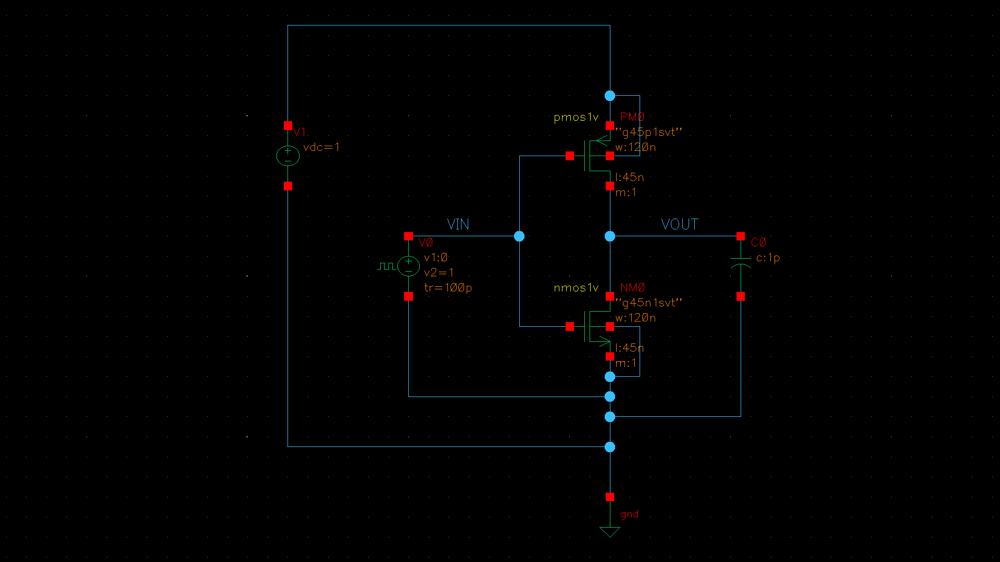
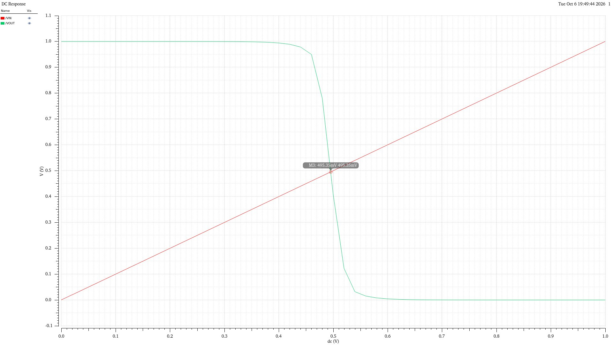
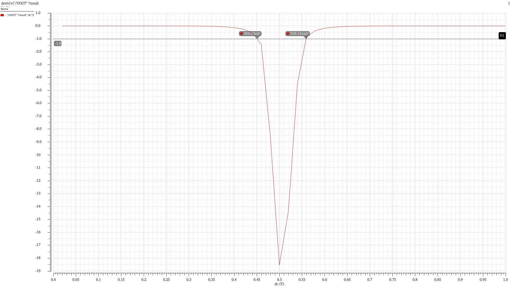
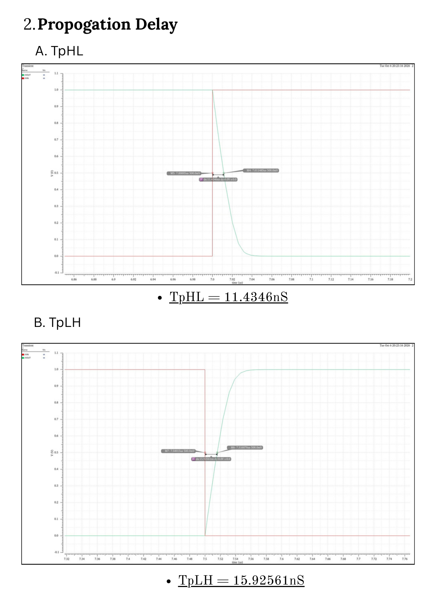
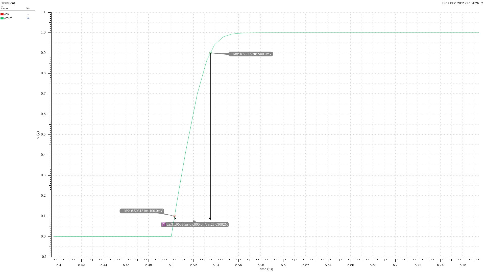
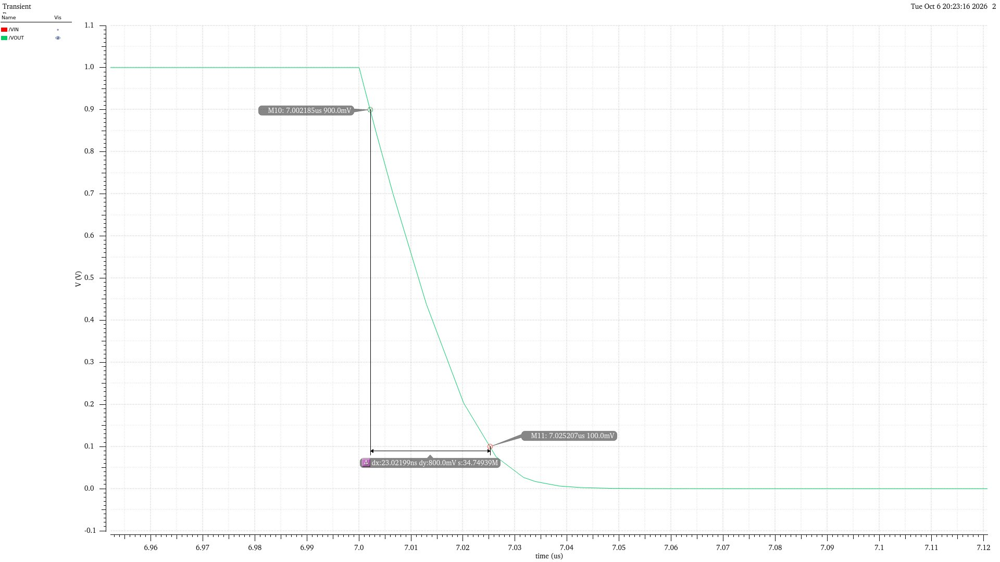
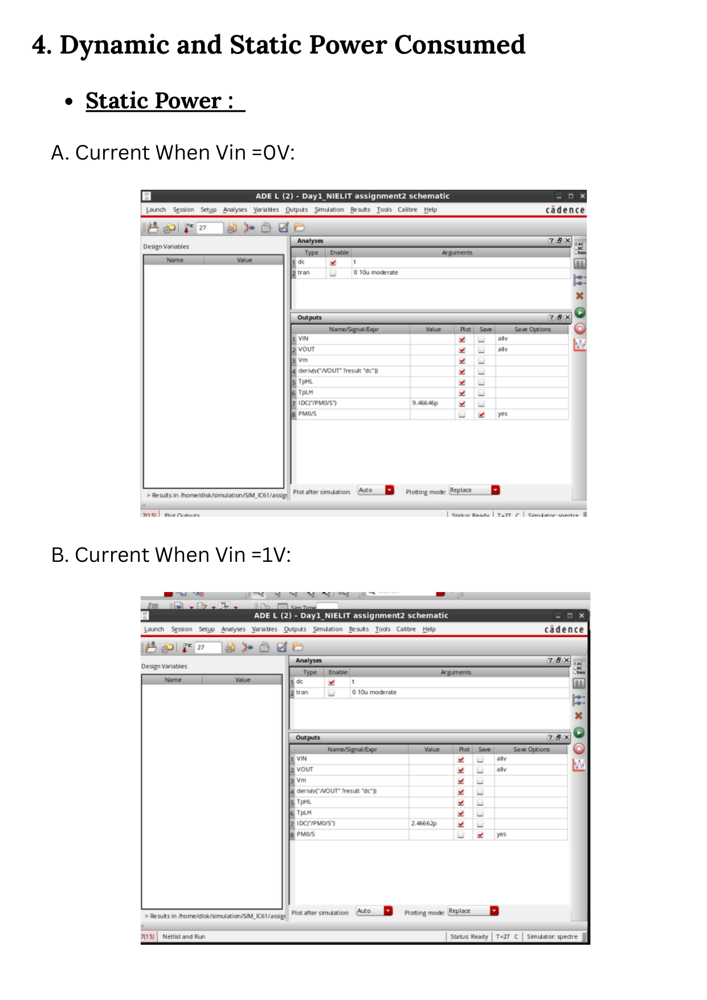

# Assignment 02 — CMOS Inverter

## Objective

Design a CMOS inverter with a switching midpoint close to \(V_{DD}/2\), verify the switching point using the voltage-transfer characteristic (VTC), and evaluate the inverter's noise margins, propagation delay, transition times, and power consumption.

## Technology and Circuit Specifications

| Parameter | Value |
|---|---:|
| PDK | GPDK45 (45 nm) |
| Supply voltage, \(V_{DD}\) | 1 V |
| PMOS width, \(W_P\) | 120 nm |
| NMOS width, \(W_N\) | 120 nm |
| PMOS length, \(L_P\) | 45 nm |
| NMOS length, \(L_N\) | 45 nm |
| PMOS multiplicity | 1 |
| NMOS multiplicity | 1 |
| Output load capacitance | 1 pF |
| Input pulse levels | 0 V to 1 V |
| Input rise-time setting | 100 ps |

## 1. CMOS Inverter Design and Switching Midpoint

The theoretical switching midpoint is:

\[
V_M = \frac{V_{DD}}{2}
\]

For \(V_{DD}=1\,\text{V}\):

\[
V_M = \frac{1}{2}=0.5\,\text{V}
\]

### Switching Midpoint for Different Transistor Widths

| Width, \(W\) | Length, \(L\) | Simulated switching midpoint, \(V_M\) |
|---:|---:|---:|
| 120 nm | 45 nm | 495.354 mV |
| 130 nm | 45 nm | 495.237 mV |
| 140 nm | 45 nm | 495.148 mV |

The minimum transistor width allowed by the GPDK45 library is 120 nm. The 120 nm device width was selected for the inverter because it gives the closest simulated switching midpoint to the theoretical value among the widths tested.

### Circuit Schematic

### Voltage-Transfer Characteristic

The VTC confirms a switching midpoint of approximately 495.354 mV for the selected 120 nm width.

## 2. Noise Margins

The extracted logic-level voltages are:

| Parameter | Value |
|---|---:|
| \(V_{OH}\) | 1 V |
| \(V_{OL}\) | 0 V |
| \(V_{IH}\) | 559.141 mV |
| \(V_{IL}\) | 450.53 mV |

### High Noise Margin

\[
NM_H = V_{OH}-V_{IH}
\]

\[
NM_H = 1-0.559141=0.440859\,\text{V}
\]

### Low Noise Margin

\[
NM_L = V_{IL}-V_{OL}
\]

\[
NM_L = 0.45053-0=0.45053\,\text{V}
\]

## 3. Propagation Delay

| Delay parameter | Simulated value |
|---|---:|
| High-to-low propagation delay, \(t_{pHL}\) | 11.4346 ns |
| Low-to-high propagation delay, \(t_{pLH}\) | 15.92561 ns |

## 4. Rise Time and Fall Time

| Transition parameter | Simulated value |
|---|---:|
| Rise time, \(T_R\) | 31.96059 ns |
| Fall time, \(T_F\) | 23.02199 ns |

**Rise-time extraction**

**Fall-time extraction**

## 5. Static and Dynamic Power

### Static Power

The simulated supply currents are:

| Input voltage | Supply current |
|---:|---:|
| \(V_{IN}=0\,\text{V}\) | 9.46646 pA |
| \(V_{IN}=1\,\text{V}\) | 2.46662 pA |

Using \(V_{DD}=1\,\text{V}\):

\[
P_{static}=V_{DD}\left[I(V_{IN}=0)+I(V_{IN}=1)\right]
\]

\[
P_{static}=1\times(9.46646+2.46662)\,\text{pA}
=11.93308\,\text{pW}
\]

### Dynamic Power

The average dynamic current is 1.00011 µA.

\[
P_{dynamic}=V_{DD}\times I_{dynamic(avg)}
\]

\[
P_{dynamic}=1\times1.00011\,\mu\text{A}
=1.00011\,\mu\text{W}
\]

## 6. Summary of Results

| Metric | Result |
|---|---:|
| Theoretical switching midpoint | 500 mV |
| Simulated switching midpoint (selected width) | 495.354 mV |
| High noise margin, \(NM_H\) | 440.859 mV |
| Low noise margin, \(NM_L\) | 450.53 mV |
| \(t_{pHL}\) | 11.4346 ns |
| \(t_{pLH}\) | 15.92561 ns |
| Rise time | 31.96059 ns |
| Fall time | 23.02199 ns |
| Static power | 11.93308 pW |
| Dynamic power | 1.00011 µW |

## Conclusion

The CMOS inverter was designed using 120 nm wide, 45 nm long PMOS and NMOS devices in the GPDK45 process with a 1 V supply. The simulated switching midpoint is 495.354 mV, which is close to the theoretical value of 500 mV. The inverter's noise margins, propagation delays, rise and fall times, and static and dynamic power were extracted from the simulations.
